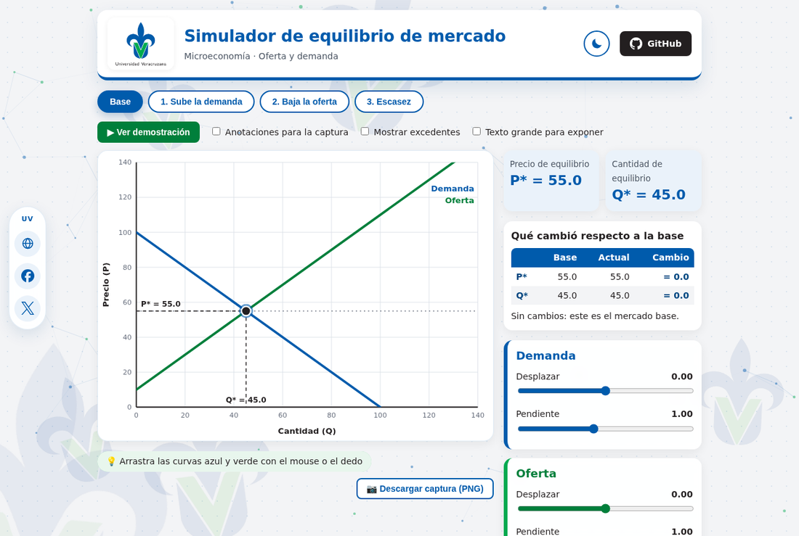
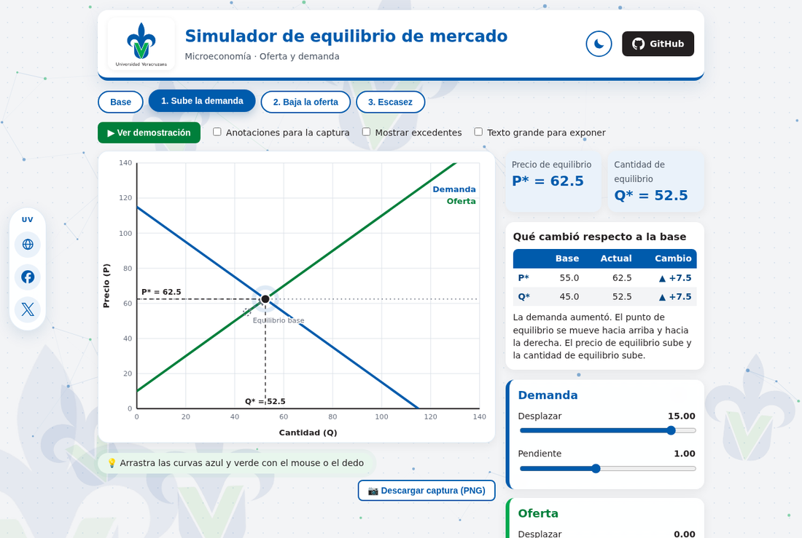
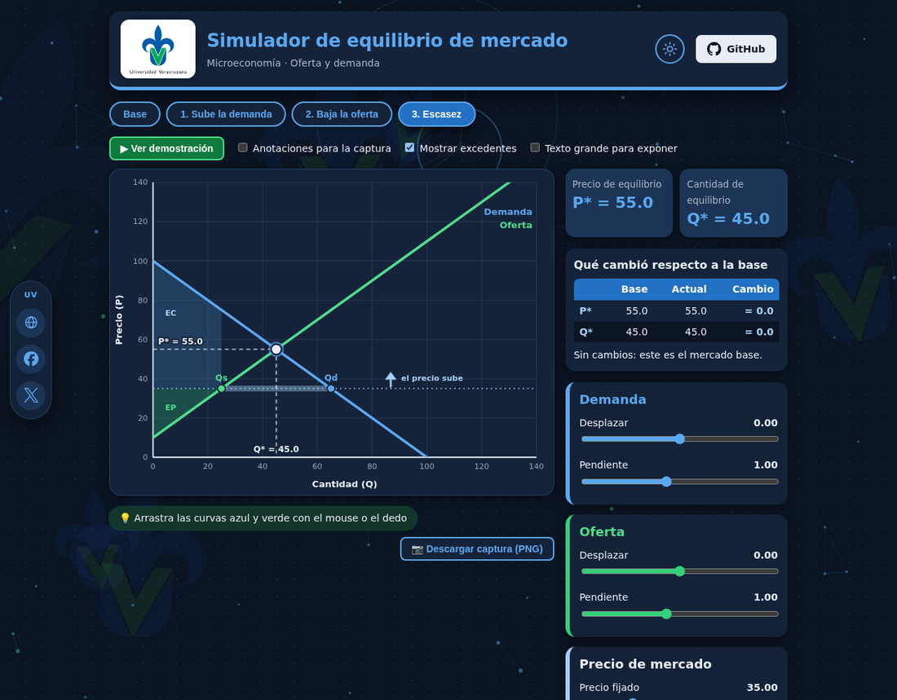
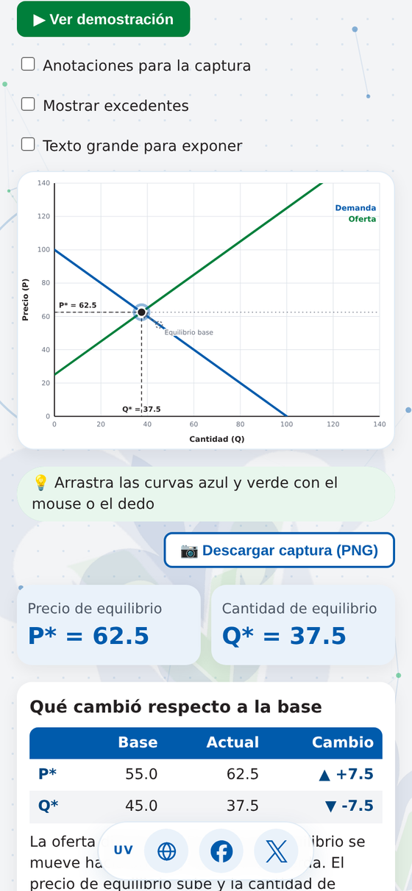

<div align="center">


# Simulador de equilibrio de mercado

**Mueve la oferta y la demanda con el mouse y mira, en tiempo real, cómo cambian el precio y la cantidad de equilibrio.**

*Proyecto académico de Microeconomía · Universidad Veracruzana*


**🔗 Demo en línea:** `https://asheeof.github.io/Simulador-Equilibrio/`

<br />



</div>

---

##  ¿De qué trata?

En un mercado, el **precio** y la **cantidad** que se intercambian no se eligen al azar: salen del encuentro entre dos fuerzas.

- 🔵 **La demanda:** cuanto más caro es un producto, **menos** unidades quieren comprar las personas.
- 🟢 **La oferta:** cuanto más caro es un producto, **más** unidades quieren vender las empresas.

El punto donde las dos curvas se cruzan es el **equilibrio**: el precio (**P\***) al que lo que la gente quiere comprar es justo lo que las empresas quieren vender (**Q\***).

Este programa convierte esa idea en algo que se puede **tocar**: arrastras las curvas, cambias su inclinación, fijas un precio por encima o por debajo del equilibrio y ves al instante qué pasa: si sobran productos, si faltan, y hacia dónde empuja el mercado al precio.

>  **Para quién es:** estudiantes que están aprendiendo oferta y demanda, y para quien necesita explicarlo con una imagen en lugar de solo fórmulas.

---

##  Así se ve

<table>
  <tr>
    <td width="50%" align="center"><b>Sube la demanda</b><br /><sub>El equilibrio se mueve arriba y a la derecha</sub><br /><br /></td>
    <td width="50%" align="center"><b>Escasez · modo oscuro</b><br /><sub>Con excedentes del consumidor (EC) y del productor (EP)</sub><br /><br /></td>
  </tr>
</table>

<div align="center">
  <br />
  <sub>También funciona en celular: las curvas se arrastran con el dedo.</sub>
</div>

---

## 📚 Conceptos clave

| Símbolo | Qué significa | Cómo se ve en el simulador |
|:---:|---|---|
| **P** | Precio | Eje vertical |
| **Q** | Cantidad | Eje horizontal |
| **Qd** | Cantidad que la gente **quiere comprar** a un precio dado | Punto azul sobre la curva de demanda |
| **Qs** | Cantidad que las empresas **quieren vender** a un precio dado | Punto verde sobre la curva de oferta |
| **P\*  y  Q\*** | Precio y cantidad de **equilibrio** | Punto negro con líneas punteadas a los ejes |
| **Exceso de demanda (escasez)** | Con un precio bajo, Qd > Qs: faltan productos y el precio tiende a **subir** | Brecha sombreada + flecha ⬆ |
| **Exceso de oferta (abundancia)** | Con un precio alto, Qs > Qd: sobran productos y el precio tiende a **bajar** | Brecha sombreada + flecha ⬇ |
| **EC / EP** | Excedente del consumidor / del productor: el "beneficio" de cada lado | Áreas azul y verde (opcional) |

---

## Cómo funciona el modelo

Las dos curvas son rectas y el equilibrio se calcula igualándolas:

```text
Demanda:  P = 100 − md · (Q − sd)        sd = desplazamiento,  md = pendiente
Oferta:   P =  10 + ms · (Q − ss)        ss = desplazamiento,  ms = pendiente

Equilibrio:
  Q* = (100 − 10 + md·sd + ms·ss) / (md + ms)
  P* = 100 − md · (Q* − sd)
```

Con los valores iniciales (`sd = ss = 0`, `md = ms = 1`) el mercado base queda en **P\* = 55** y **Q\* = 45**. Todo el cálculo vive en [`src/modelo.js`](src/modelo.js) y está cubierto por pruebas automáticas.

---

##  Qué puedes hacer

<table>
  <tr>
    <td valign="top" width="50%">

###  Interactuar
- **Arrastrar** las curvas de oferta y demanda con el mouse o el dedo
- **Sliders** de desplazamiento y pendiente para cada curva
- **Fijar un precio** de mercado y ver el exceso de oferta o de demanda
- Botón **"Igualar al equilibrio"** y **"Restablecer todo"**

###  Entenderlo
- **Escenarios con un clic**, con transiciones animadas
- **Demostración guiada** paso a paso con explicaciones
- Tabla **"Qué cambió"** respecto al mercado base, con flecha de cómo se movió el equilibrio
- **Excedentes** del consumidor y del productor (opcional)

    </td>
    <td valign="top" width="50%">

### Presentarlo
- **Descargar captura (PNG)** eligiendo nombre y carpeta, con título, logotipo y valores
- Modo de **anotaciones** que señala cada elemento de la gráfica
- **Texto grande** para exponer en proyector
- La captura respeta el **modo claro u oscuro** activo

### Disfrutarlo
- **Modo claro y oscuro** (recuerda tu elección)
- Fondo animado en **JavaScript (canvas)**: partículas que reaccionan al mouse y logos de la UV con parallax
- Barra anclada con las **redes oficiales** de la Universidad Veracruzana
- Respeta la preferencia de **movimiento reducido** del sistema

    </td>
  </tr>
</table>

---

##  Escenarios incluidos

Se cargan con un clic desde los botones de arriba de la gráfica:

| Escenario | Qué cambia | Resultado |
|---|---|---|
| **Base** | Valores iniciales | P\* = 55 · Q\* = 45 |
| **1. Sube la demanda** | La demanda se desplaza 15 a la derecha | P\* = 62.5 ▲ · Q\* = 52.5 ▲ |
| **2. Baja la oferta** | La oferta se desplaza 15 a la izquierda | P\* = 62.5 ▲ · Q\* = 37.5 ▼ |
| **3. Escasez** | El precio se fija en 35 (por debajo de P\*) | Qd = 65 · Qs = 25 · **brecha = 40** |

---

## Cómo ejecutarlo

Necesitas [Node.js](https://nodejs.org/) **20.19 o superior** (o 22.12 en adelante).

```bash
npm install      # instala las dependencias
npm run dev      # abre el simulador en modo desarrollo
```

| Comando | Para qué sirve |
|---|---|
| `npm run dev` | Servidor de desarrollo con recarga automática |
| `npm run build` | Genera la versión de producción en `dist/` |
| `npm run lint` | Revisa el código con Oxlint |
| `npm test` | Corre las pruebas del modelo (Vitest) |

---

##  Tecnologías

| Tecnología | Para qué se usa |
|---|---|
| **React** | Interfaz y estado de las curvas |
| **Vite** | Servidor de desarrollo y compilación |
| **JavaScript (ES modules)** | Lógica del modelo económico |
| **SVG** | Gráfica de oferta y demanda, escalable y nítida |
| **CSS con variables** | Paleta, modo claro y oscuro |
| **Vitest** | Pruebas automáticas del modelo |
| **Oxlint** | Revisión de código |

---

## 🗂️ Estructura del proyecto

```text
simulador-equilibrio/
├── public/                  Logotipos y favicon
├── docs/capturas/           Imágenes de este README
├── src/
│   ├── modelo.js            Cálculo del equilibrio, cantidades y excedentes
│   ├── modelo.test.js       Pruebas del modelo
│   ├── App.jsx              Pantalla principal y animaciones entre escenarios
│   ├── config.js            Enlaces de GitHub, redes de la UV y tecnologías
│   ├── exportar.js          Captura PNG
│   ├── useTema.js           Modo claro / oscuro
│   ├── useAnimacion.js      Transiciones suaves entre escenarios
│   ├── index.css            Paleta y variables de color
│   ├── App.css              Estilos de la interfaz
│   └── components/          Gráfica (Plano, Curvas, Equilibrio, Excedentes…),
│                            controles, fondo animado, barra de redes, etc.
└── .github/workflows/       Publicación automática en GitHub Pages
```

---

##  Rendimiento

- **Fondo animado ligero:** el canvas se dibuja a resolución 1x, se pausa cuando la pestaña no está visible y evita los desenfoques costosos.
- **Imágenes optimizadas:** logotipos redimensionados y comprimidos; el sitio completo pesa unos 350 KB sin comprimir.
- **Movimiento reducido:** si el sistema lo pide, las animaciones se desactivan y los cambios son instantáneos.

---

## 🎨 Personalización

| Quiero cambiar… | Dónde |
|---|---|
| Mis enlaces de GitHub y la lista de tecnologías | `src/config.js` |
| Las redes de la UV de la barra lateral | `REDES_UV` en `src/config.js` |
| Los colores (claro y oscuro) | Variables `--t-*` y `--uv-*` en `src/index.css` |
| La intensidad del fondo animado | `src/components/FondoCanvas.jsx` |
| El nombre que se propone al descargar la captura | `nombreSugerido` en `src/exportar.js` |
| Los valores base de las curvas | `PD0`, `PS0` y `BASE` en `src/modelo.js` |

---

## 🌐 Publicación en GitHub Pages

El repositorio incluye un flujo de GitHub Actions que revisa el código, corre las pruebas y publica el sitio cada vez que se sube un cambio a la rama `main`.

1. En GitHub, entra a **Settings → Pages**.
2. En **Source**, elige **GitHub Actions**.
3. Sube tus cambios a `main` y espera a que termine el flujo en la pestaña **Actions**.


[⬆ Volver arriba](#-simulador-de-equilibrio-de-mercado)

</div>
